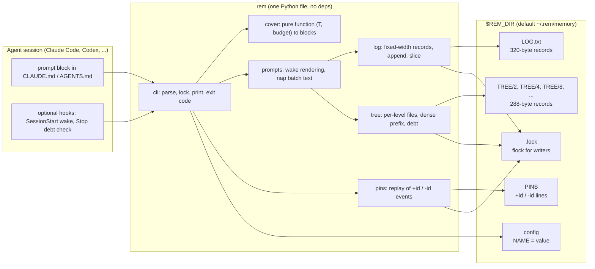
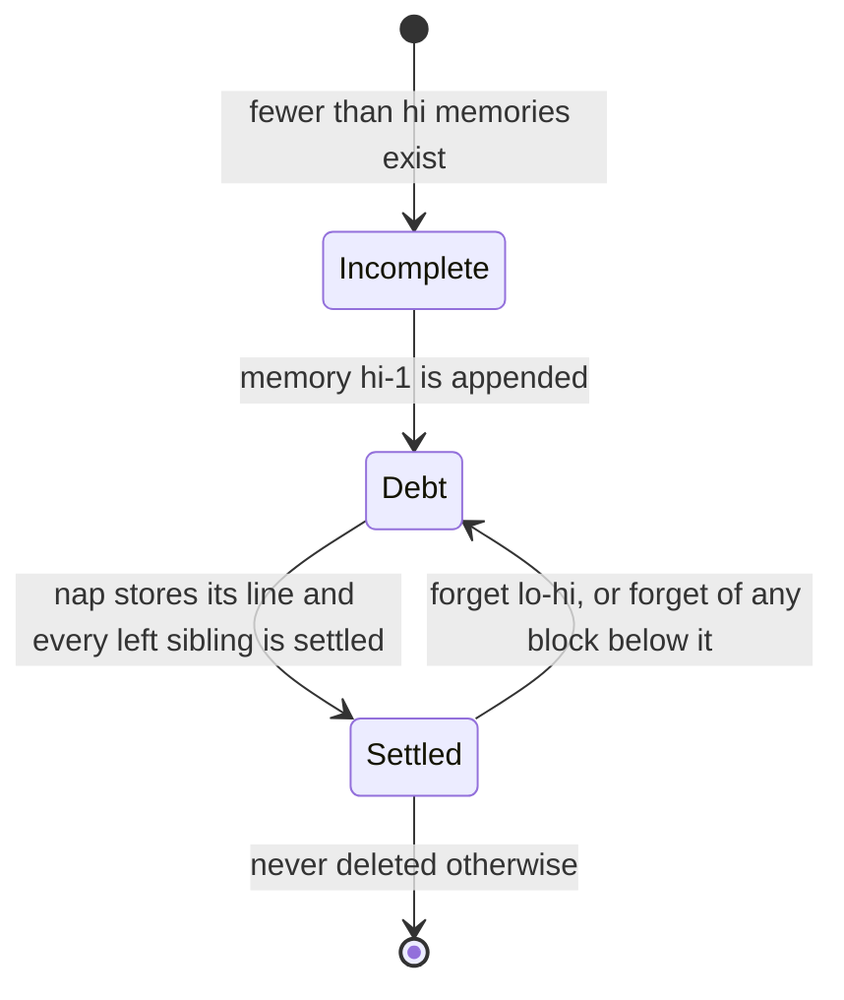
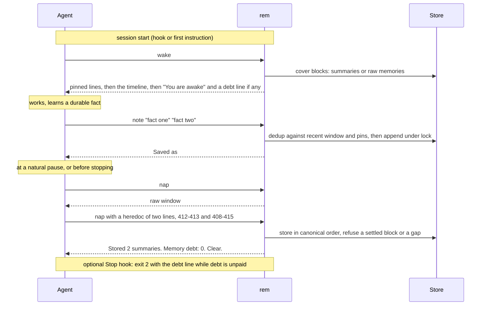

# rem: architecture

For an operator or a model that has to understand, operate, or change rem. The design
rationale and the comparison with OptMem are in [design.md](/docs/design.md); this file is the
"what is where and what happens when" view.

## 1. The one-paragraph version

rem is a command-line tool, not a service. The agent calls it; it never calls a model and
nothing runs in the background. Memories are one-line facts in an append-only log. Over the
log sits an implicit binary tree of one-line summaries, written by the agent itself and
cached on disk. `wake` prints the whole memory in a fixed number of lines by choosing, for
every stretch of the log, either the raw memories (recent) or a summary (old). A summary that
is missing is *debt*; the agent pays debt in one batch, at a pause, with `nap`.

## 2. Components



Boundaries, as enforced in the code (sections of `rem` in file order):

| Section | Owns | Never does |
|---|---|---|
| knobs | the seven sizes, their defaults, the record widths | IO |
| store | paths, `store()` existence check, `Lock`, config parse/write | content |
| log | ids, dates, text; `log_append` is the only writer of `LOG.txt` | summaries |
| tree | summaries keyed by block; `tree_put`, `tree_drop`, `pending` | the log |
| pins | the in-view set as an append-only event replay | the log, the tree |
| cover | `cover(T, budget)` and `decomposition(T)`; pure | IO |
| prompts | `render` (wake lines), `nap_batch` (debt prompt), the `TEMPLATE` | writes |
| commands | one function per verb; validation; user-facing messages | file formats |
| cli | `main`: dispatch, `Bad` to exit 1, `OSError` to one line | logic |

## 3. The store: position is identity

```
LOG.txt                                      TREE/2            TREE/4         TREE/8
byte 0    "#0 2026-11-04 first fact      \n"   k=0: sum(#0-1)    k=0: sum(#0-3)  k=0: sum(#0-7)
byte 320  "#1 2026-11-04 second fact     \n"   k=1: sum(#2-3)    k=1: sum(#4-7)
byte 640  "#2 ..."                             k=2: sum(#4-5)
byte 960  "#3 ..."                             k=3: sum(#6-7)
...
memory i is at byte i*320                      block k of size s is at byte k*288 of TREE/s
```

Consequences that the rest of the design leans on:

- A lookup is one `seek`. There is no index to maintain or corrupt.
- `log_len` is `size(LOG.txt) // 320`. The number of settled summaries at a level is
  `size(TREE/s) // 288`. Debt is arithmetic: blocks with `hi <= T` beyond that count.
- Every level is a dense prefix: block k at level s exists only if blocks 0..k-1 do. `nap`
  therefore stores a batch in canonical order (smallest level first, left to right) and
  reports the first gap it cannot fill.
- A crash mid-write leaves a torn trailing record. `repair()` truncates to the record
  boundary under the lock before the next write. Nothing earlier can be damaged.
- Writers take `flock` on `.lock`. Readers take nothing; `wake k T` pins its snapshot at
  `T`, so a paginated wake is stable while another process appends.
- `LOG.txt` and `TREE/` are byte-identical to OptMem's; `PINS` and `config` are additions.

## 4. The block state machine

A block is an aligned power-of-two range `[lo, hi)` of memory ids: `0-1`, `2-3`, `0-3`,
`4-7`, `0-7`, ... (printed as `lo-(hi-1)`).



Appending one memory completes at most `log2(T)` blocks, so debt grows by about one
summary per note on average and is paid in one `nap` per session.

## 5. What `wake` prints: the cover

`cover(T, WAKE_LINES)` tiles `[0, T)` with at most `WAKE_LINES` aligned blocks, finest
toward the present. It is a greedy priority split: start from the coarsest tiling (the
binary decomposition of `T`), repeatedly split the block with the largest `size / age`
(age = `T - lo`), stop when the budget is spent. Result for 2000 memories and 96 lines:

```
#0-1023   one summary line                 (oldest thousand: one line)
#1024-1535 one line
#1536-1791 one line
...                                        (block size halves as blocks get newer)
#1984-1991 one line
#1992-1995 one line
#1996-1997 one line
#1998      verbatim
#1999      verbatim                        (newest memories: raw)
```

Each cover block renders as its summary; a missing summary renders as its two children,
recursively, down to raw memories. `render` carries a line limit of
`WAKE_LINES * DEBT_SLACK` and stops the moment the walk would pass it, so a store deep in
debt refuses in a few milliseconds with a pointer to `nap` rather than reading the whole
log. The refusal exits 0 because it is an instruction to the agent, not a tool failure.

Pins are the one non-recency axis: ids the agent marked as "in view every session". They
print verbatim above the timeline and are charged to the same budget (floor: half of
`WAKE_LINES`), with a warning past `PIN_LINES`.

## 6. A session



The nap prompt is organised by input, not by output: every pending block that is summarised
from raw memories (size up to `RAW_MAX`) is listed under one copy of its raw window, and
higher blocks cite their two halves, each either a stored summary or "the line you write
above". That is why a boundary costs one round trip, not `log2(T)`.

## 7. Cost model

| Operation | Disk | Tokens into the agent | Tokens out of the agent |
|---|---|---|---|
| `wake` | about 100 seeks, independent of log size | at most `WAKE_LINES` + pins lines; typically 1.5k to 3k tokens, 7k worst case at full 280-byte lines | none |
| `note` | one 1.3 MB sequential read (dedup window), one append | one or two lines | the memory text |
| `nap` (print) | the pending raw windows | at most `PART_CHARS` (20 KB, about 5k tokens) | none |
| `nap` (store) | one append per summary | a few lines | one line per summary, at most `NAP_MAX` |
| `recall` | full scan of log and tree | the matches, capped at `PART_CHARS` | the regex |
| prompt block | none | about 340 tokens per session | none |

Steady state: a session with ten notes pays roughly ten summary lines in one nap.
A bulk import of N memories owes N-1 summaries, paid in about N/60 naps.

## 8. Failure modes and what the tool does

| Situation | Behaviour |
|---|---|
| process killed mid-append | torn record truncated by the next writer; ids stay aligned |
| two processes note at once | `flock` serialises; ids never collide (tested with 16) |
| summary blank or not UTF-8 | `wake` names `forget lo-hi`; `nap` rebuilds it from the log |
| agent submits a summary out of order | stored prefix kept, first gap reported |
| agent submits a summary for a settled block | ignored, "already settled" |
| debt beyond `DEBT_SLACK * WAKE_LINES` | `wake` refuses in O(budget) time, exit 0, `Run: nap` |
| `ENTRY_CHARS` raised above the record | refused: the record width is the hard cap |
| store missing | every command exits 1 naming `init` |
| no store synchronisation across machines | out of scope: the lock is per machine; use one store per machine or a synced folder with one writer at a time |

## 9. Where to change what

- A new size: add to `KNOBS`; `config`, the config file, and `usage` pick it up.
- A new verb: one `cmd_<name>(d, args)` in commands, one entry in `COMMANDS`, one line
  in `usage()`, and (only if agents must know it) one clause in `TEMPLATE`. The template
  is measured in `test_rem.py` section 2; keep it under 450 tokens.
- Anything that changes `LOG.txt` or `TREE/` byte layout breaks OptMem compatibility and
  section 13 of the tests; that is a deliberate stop condition.
- Tests: `python3 test_rem.py`, in-process through `COMMANDS` plus subprocess checks for
  exit codes, concurrency and PATH. Add checks to the numbered section they belong to.
